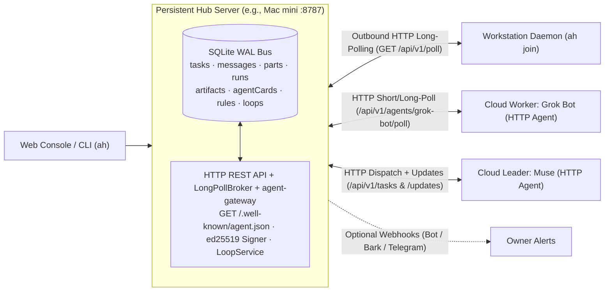

# a2a-hub

**A self-hosted, zero-external-dependency multi-agent orchestration hub** — combining the **A2A eight-state model**, **three-layer addressing (`Node` → `Worker` → `Skill`)**, **instruction/data separation**, and **ed25519-signed approvals** over one unified **SQLite WAL + HTTP Gateway** architecture (outbound HTTP Long-Polling for host daemons + REST Agent Gateway for pure cloud/cron Agents), with a built-in **Web Console** and **LoopForge multi-stage SOP orchestration engine**.

[中文说明](README.md) · [Standard (Chinese)](docs/standard.md) · [Configuration & CLI](docs/configuration.md) · [HTTP Agent Runbook](docs/protocol-node-runbook.md) · [Architecture](docs/architecture.md) · [Security Model](SECURITY.md) · [Changelog](CHANGELOG.md)

[](LICENSE)


---

## Why `a2a-hub`

- **Self-Hosted Standalone Hub (`busType: "sqlite"`)**: Run `ah daemon --role hub` on a persistent server (such as a Mac mini or Linux VPS) backed by Node >= 24's built-in `node:sqlite` (WAL mode) and zero third-party npm dependencies (`dependencies: {}`).
- **Two Connection Modes Over Pure HTTP, Zero Open Node Ports**:
  - **Host Daemon Nodes (`ah join`)**: Workstations, office Macs, or GPU hosts run a thin outbound daemon (`GET /api/v1/poll`) that wakes within milliseconds to execute local CLIs/scripts safely via `commands.json`.
  - **Pure HTTP External Agents (Muse, Grok Bot, etc.)**: No daemon. The owner issues a per-agent token in the console (not the owner `AH_API_TOKEN`). `GET /.well-known/agent.json` is public; `/api/v1/skills*` and every other API call need that token. A timer runs the check script every 5 minutes: `IDLE` stops, `WORK` then calls `poll?timeout=0` or `updates?new=1`. If no script can run, the fallback is also every 5 minutes. A leader both claims and follows up. Each run starts with no prior context.
- **Built-in Web Console** (`http://<hub>:8787`, owner token):
  - **Needs you**: Home list of approvals, questions, and tasks worth a look.
  - **Agents**: Grouped by node, with admission, display names, and token rotate/revoke.
  - **Dispatch**: Plain-language form.
  - **Add Agent**: Three steps (access type, name and role, token plus onboarding). HTTP agents get a one-time token.
  - **Tasks and SOP**: Task detail with ed25519 approve/reject, replies, and the LoopForge studio.
- **LoopForge-style SOP Orchestration Engine (`LoopService`)**: Automate multi-stage pipelines (e.g. `plan → code → verify`) under a shared `Context_ID` with `Ref_Task_IDs`. Verify failures feed structured diagnostics (`retry` / `goto:<stage_id>` / `abort`) back to earlier stages, bounded by `Max_Iterations` and `HOP_LIMIT = 8`.
- **Optional Webhook Notifications**: Configure `notifications` in `node.json` to push alerts via group bot webhooks, Bark, Telegram, or generic webhooks.

---

## Architecture Overview



### 1. Three-Level Addressing: `Node → Worker → Skill`

- **Node**: A physical or virtual machine (`mac-mini-hub`, `edge-node-1`).
- **Worker**: An agent runtime template configured under `workers` in `commands.json` (represented in `AgentCards` with `Skill_ID=agent`).
- **Skill**: A specialized skill targeting `workers: [...]` or a deterministic node script (`mode: json`).
- Console and prompt wording: 节点 = Node, Agent = Worker (`Skill_ID=agent`), 能力 = Skill. API fields stay `node`, `Worker`, and `Skill_ID`.

### 2. Eight-State A2A Task Lifecycle

Tasks progress strictly across the eight A2A states: `submitted` → `working` ↔ `input-required` / `auth-required` → terminal (`completed` / `failed` / `canceled` / `rejected`). Terminal tasks are immutable; follow-up tasks share `Context_ID` and reference predecessors via `Ref_Task_IDs`.


---

## Quick Start

### Prerequisites

- **Node.js >= 24** (uses built-in `node:sqlite`, `node:http`, `node:crypto`, and global `fetch`; zero npm install needed).

### Option A: True 1-Line Install & Start (Recommended)

**1) Start the Standalone Hub (e.g., on a Mac mini / Linux host):**

```bash
curl -fsSL https://raw.githubusercontent.com/backtomyfuture/a2a-hub/main/install.sh | sh -s -- --hub
```

This generates an ed25519 approval keypair + random `apiToken`, configures SQLite WAL, registers user-level autostart (add `--no-service` to run foreground-only), and prints:
- A one-click Web Console URL `http://<LAN_IP>:8787/?token=...` (saved to `localStorage` and scrubbed from the address bar on load)
- A copy-paste 1-line join command for worker machines.

**2) Connect a Remote Edge Node (Outbound Long-Polling Only, Zero Open Ports):**

```bash
# macOS / Linux:
curl -fsSL https://raw.githubusercontent.com/backtomyfuture/a2a-hub/main/install.sh | sh -s -- --join "http://<AH_API_TOKEN>@<HUB_IP>:8787"

# Windows PowerShell:
$env:AH_JOIN = "http://<AH_API_TOKEN>@<HUB_IP>:8787"; irm https://raw.githubusercontent.com/backtomyfuture/a2a-hub/main/install.ps1 | iex
```

`--join` extracts the embedded token into mode-600 `app.env` (never written to `node.json`), fetches `hubPublicKey` from `GET /api/v1/health`, and starts the outbound long-polling daemon/service.

### Option B: From a Cloned Checkout

```bash
git clone https://github.com/backtomyfuture/a2a-hub.git
cd a2a-hub
# Optional: expose `ah` / `a2a-hub` / `ahub` globally
npm link

# 1) Start the Hub in one line (add --service to register autostart):
node bin/ah.mjs up

# 2) Join from any worker machine (add --service for autostart):
node bin/ah.mjs join http://<AH_API_TOKEN>@<HUB_IP>:8787
```

### Option C: Connect Pure HTTP External Agents (Muse / Grok Bot, No Daemon)

Cloud Agents do not install a daemon. Add the agent in the Web Console, copy its per-agent token (shown once), and pick a receive mode: scheduled check (default, `receive_mode=http-poll`), resident long-poll (`http-longpoll`), or a webhook doorbell (`webhook`; the owner sets the URL, and the push has no instruction body). Discovery at `GET http://<HUB_IP>:8787/.well-known/agent.json` is unauthenticated. Skill fetch (`GET /api/v1/skills/a2a-leader` or `a2a-worker`) and every other call need that token. `<AGENT_TOKEN>` below is not the owner `AH_API_TOKEN`. The sample is the scheduled check.

```bash
# 1) Register a Leader (Muse, every 15 minutes) or Worker (Grok Bot, every 10 minutes)
curl -X POST http://<HUB_IP>:8787/api/v1/agents/register \
  -H "Authorization: Bearer <AGENT_TOKEN>" -H "Content-Type: application/json" \
  -d '{"node":"muse","role":"leader","kind":"agent","receive_mode":"http-poll"}'

curl -X POST http://<HUB_IP>:8787/api/v1/agents/register \
  -H "Authorization: Bearer <AGENT_TOKEN>" -H "Content-Type: application/json" \
  -d '{"node":"grok-bot","role":"worker","kind":"agent","receive_mode":"http-poll","caps":[{"skill_id":"research","skill_name":"Grok Research"}]}'

# 2) Muse dispatches, then reads only new changes (new terminals + still-open questions/approvals)
curl -X POST http://<HUB_IP>:8787/api/v1/tasks \
  -H "Authorization: Bearer <AGENT_TOKEN>" -H "Content-Type: application/json" \
  -d '{"from":"muse","to":"grok-bot","cap":"research","text":"Compare HTTP poll vs long-poll"}'
curl -H "Authorization: Bearer <AGENT_TOKEN>" \
  "http://<HUB_IP>:8787/api/v1/agents/muse/updates?new=1"

# 3) Grok Bot short-polls, then claims and finishes in the same run
curl -H "Authorization: Bearer <AGENT_TOKEN>" \
  "http://<HUB_IP>:8787/api/v1/agents/grok-bot/poll?timeout=0"
curl -X POST "http://<HUB_IP>:8787/api/v1/tasks/<TASK_ID>/claim" \
  -H "Authorization: Bearer <AGENT_TOKEN>" -H "Content-Type: application/json" -d '{"node":"grok-bot"}'
curl -X POST "http://<HUB_IP>:8787/api/v1/tasks/<TASK_ID>/complete" \
  -H "Authorization: Bearer <AGENT_TOKEN>" -H "Content-Type: application/json" \
  -d '{"node":"grok-bot","text":"Comparison report ready","artifact":"https://example.com/report.md"}'
```

See [HTTP Agent Runbook](docs/protocol-node-runbook.md) for the full lifecycle API.

<details>
<summary>Advanced: Manual step-by-step setup / custom flags</summary>

1) Standalone Hub:

```bash
node bin/ah.mjs setup \
  --role hub \
  --bus sqlite \
  --node mac-mini-hub \
  --zone home \
  --prefix mm \
  --listen 0.0.0.0:8787 \
  --public-url http://127.0.0.1:8787 \
  --api-token "<YOUR_SECRET_TOKEN>" \
  --yes

node bin/ah.mjs doctor --role hub
node bin/ah.mjs daemon --role hub
node bin/ah.mjs service --role hub
```

2) Manual Remote Edge Node (see [`config/node.remote.example.json`](config/node.remote.example.json) and [`config/commands.example.json`](config/commands.example.json)):

```bash
node bin/ah.mjs setup \
  --role node \
  --bus http \
  --hub-url http://<HUB_IP>:8787 \
  --api-token "<AH_API_TOKEN>" \
  --hub-key "<HUB_ED25519_PUBLIC_KEY>" \
  --node edge-node-1 \
  --zone office \
  --prefix e1 \
  --yes

node bin/ah.mjs doctor
node bin/ah.mjs daemon
```

</details>

---

## Agent Skills (2x2 Matrix)

Skills are separated along **Leader vs. Worker** and **CLI (`ah`) vs. Pure HTTP** so local sub-agents and cloud bots never receive conflicting instructions:

| Role \ Runtime | Local with `ah` CLI | Pure HTTP (Cloud / Cron Agent, no CLI) |
|---|---|---|
| **Controller / Leader** (inspect, dispatch, loops, collect updates) | [`skills/ah/SKILL.md`](skills/ah/SKILL.md) | [`skills/a2a-leader/SKILL.md`](skills/a2a-leader/SKILL.md) (`GET /api/v1/skills/a2a-leader`, authenticated) |
| **Executor / Worker** (poll, claim, ask, auth, complete/fail) | [`skills/ah-inbox/SKILL.md`](skills/ah-inbox/SKILL.md) (auto-installed for `kind=agent`) | [`skills/a2a-worker/SKILL.md`](skills/a2a-worker/SKILL.md) (`GET /api/v1/skills/a2a-worker`, authenticated) |

---

## Common Commands (`ah`, aliases: `a2a-hub` / `ahub`)

Configuration defaults to `~/.a2a-hub` (app installed under `~/.a2a-hub/app/`, override with `--config <dir>` or `AH_HOME`). See [Configuration & CLI](docs/configuration.md) for the complete reference.

| Area | Command | Purpose |
|---|---|---|
| **One-Line Setup** | `ah up [--listen …] [--service] [--no-daemon]` | Initialize SQLite Hub (auto token + ed25519 key) and start |
| | `ah join <hub_url> [--node …] [--service] [--no-daemon]` | Extract credentials, sync `hubPublicKey`, and start long-poll node |
| **Setup & Ops** | `ah setup [--role node\|hub] [--bus sqlite\|http]` | Initialize a standalone SQLite Hub or remote HTTP node |
| | `ah daemon [--role node\|hub]` | Start the node or full Hub runtime (HTTP server, Web UI, Loops) |
| | `ah doctor [--role node\|hub]` | Read-only checks for config, `commands.json`, bus connectivity, autostart |
| | `ah service [--role node\|hub] [--remove]` | Install or remove user-level autostart (launchd / systemd / Windows) |
| | `ah inventory` | Inspect this node's AgentCards and task counts |
| | `ah reconcile` | Run a single sweep/reconciliation pass and exit |
| **Tasks & Debug** | `ah task create --to <node> [--worker <W>] [--cap <skill>] --text …` | Validate roster and create a task |
| | `ah present [--wait <sec>] [--task <ID>] [--pop]` | Read or wait for receipts in `present_queue.jsonl` |
| | `ah task reply --task <ID> --text …` | Reply to an `input-required` question and resume the task |
| | `ah task cancel --task <ID> [--text …]` | Cancel a non-terminal task |
| | `ah task why <ID> [--json]` | Reconstruct full timeline, acceptance summary, and local flight/outbox state |
| **LoopForge SOP** | `ah loop templates` | List built-in multi-stage SOP templates (e.g., `plan-code-verify`) |
| | `ah loop create --title … --goal … --to <node> [--template …]` | Launch an automated multi-stage closed loop |
| | `ah loop ls [--json]` / `ah loop show <Loop_ID>` | Inspect active and completed loops and stage history |
| | `ah loop cancel <Loop_ID> [--text …]` | Cancel a loop and its active task |
| **Local Scheduling & Inbox** | `ah schedule ls \| add \| rm \| enable \| disable` | Manage local `schedules.json` cron jobs |
| | `ah inbox [--pop] [--json]` / `ah inbox done \| ask \| fail \| auth` | Consume `agent_inbox.jsonl` and report results from standalone agents |

---

## Security Model

See [SECURITY.md](SECURITY.md) for full trust boundaries:

- **Edge nodes are outbound-only**: No open ports or reverse tunnels on worker nodes; only the Hub exposes its configured HTTP bind address with Bearer token protection (`GET /api/v1/health` exposes only minimal health metadata).
- **Instruction/data separation**: Executable templates, `cwd`, and `verify` live strictly in local `commands.json`. Task inputs are written to mode-600 `runs/<Task_ID>/input.json`; requests containing control keys (`command`, `cwd`, `context`, `agent`, `verify`, etc.) in params are rejected.
- **ed25519-signed approvals**: The Hub signs `auth_decision` records with `approval_key.pem` (`0600`) bound to `Task_ID` + `Status_Msg`. Nodes configured with `hubPublicKey` reject forged or unsigned decisions.
- **Secrets never committed**: `app.env`, `approval_key.pem`, `hub.db*`, `*_state.json`, and `runs/` are excluded in `.gitignore`.

---

## Testing

Zero external dependencies — run the full Node built-in `node:test` suite directly:

```bash
npm test
```

## License

[MIT](LICENSE)
