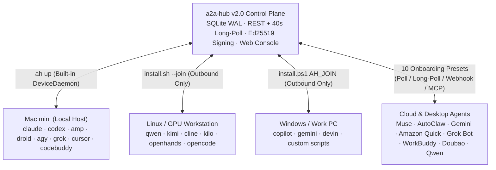
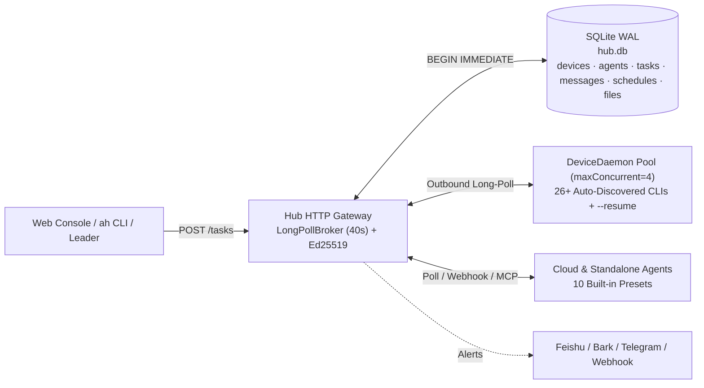
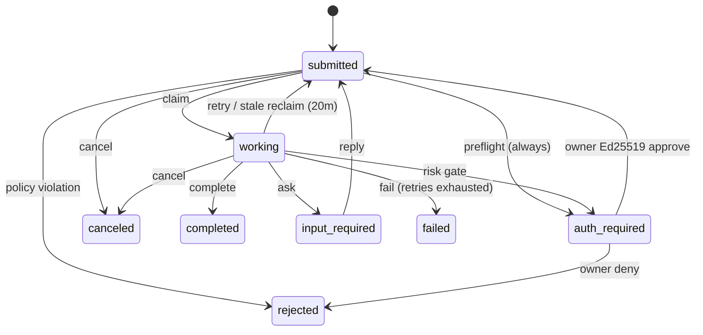

<div align="center">

# a2a-hub

**Zero-Dependency, Self-Hosted Personal Multi-Agent Orchestration Hub (v2.0)**

Unify cloud chatbots & Leader agents with local coding CLIs across your computers (Claude Code, Codex, Amp, Droid, Antigravity, Grok, Cursor, OpenCode, Qwen, Kimi — **26+ CLIs auto-discovered**) inside one minimal control plane backed by SQLite WAL, 40s outbound HTTP long-polling, Ed25519 approval signing, and a zero-build Web console.

<p>
  <a href="README.md">简体中文</a> ·
  <a href="README.en.md"><strong>English</strong></a> ·
  <a href="docs/architecture.md">Architecture</a> ·
  <a href="docs/configuration.md">Configuration</a> ·
  <a href="docs/standard.md">A2A Spec</a> ·
  <a href="SECURITY.md">Security</a>
</p>

<p>
  <a href="LICENSE"></a>
  = 24" />
  
  
  
  
</p>

</div>

---



---

## Why `a2a-hub`

- **One-Line Start Without `git clone`**: Zero external npm dependencies (`dependencies: {}`). A single installer bootstraps Node.js 24 LTS (if missing, SHA-256 verified into `~/.local/node`), installs `ah`, initializes SQLite + Ed25519 keys, and prints a one-click login console URL.
- **Zero-Prerequisite Machine Onboarding**: Adding a fresh Mac, Linux box, or Windows PC doesn't require pre-installing `ah` or Node. The Web UI generates a **single unified command** that installs Node 24 + `ah`, connects with embedded credentials, scans 26 local CLI tools, and registers a background service — purely outbound, zero open inbound ports.
- **26+ Auto-Discovered CLI Workers & True Concurrency**: Automatically discovers local CLIs (Claude Code, Codex, OpenCode, Amp, Droid, Agy, Grok, Cursor Agent, CodeBuddy, Copilot, Qwen, Kimi, Kiro, Cline, Kilo, Auggie, Vibe, Crush, Pi, Devin, OpenHands, iFlow, Qoder, Gemini, Aider, Goose). Each host executes up to `maxConcurrent = 4` tasks in parallel while serializing per `(context_id, worker_key)` to protect native CLI `--resume` sessions.
- **10 Cloud & Desktop Agent Presets**: Ready-to-use onboarding prompts with scoped per-agent tokens for **Muse / AutoClaw (Leaders)**, Gemini Desktop, Amazon Quick, Grok Bot, WorkBuddy, Doubao, Lingguang, Qwen, and a generic template.
- **Native MCP Gateway**: A built-in zero-dependency MCP server (Streamable HTTP at `/api/v1/mcp`, plus local stdio via `ah mcp`) lets MCP clients such as Gemini Desktop, Amazon Quick, Claude Desktop, and Cursor register, dispatch, claim, and submit receipts without hand-written REST calls.
- **End-to-End Task Attachments**: Dispatches, replies, questions, and receipts can carry files (`hub://files/<id>`). Fan-out grants download access to every target node, and device hosts download attachments into the run directory and list their names and paths in the CLI prompt.
- **Strict Execution Isolation & Ed25519 Signed Approvals**: Task payloads can never inject `command`, `cwd`, or `env` keys (`HTTP 400`). Risk-gated `auth-required` tasks can only be unlocked by the owner's Ed25519 signature, verified locally on the worker host via `hubPublicKey`.
- **Minimalist Zero-Build Web Console**: Light/dark themes, two-column command dashboard, device-grouped collapsible worker view with instant search, grouped fan-out dispatcher, `Context_ID` threads, and scheduled job telemetry.

---

## 1-Minute Quick Start (No `git clone` Needed)

> **Zero prerequisites**: If Node.js >= 24 is not installed yet, the installer automatically downloads and SHA-256 verifies official Node 24 LTS into `~/.local/node` without root privileges.

### Option 1: One-Line Local Hub (Mac mini / Linux / Windows)

**macOS / Linux** (Terminal):

```sh
curl -fsSL https://raw.githubusercontent.com/backtomyfuture/a2a-hub/main/install.sh | sh -s -- --hub
```

**Windows** (PowerShell):

```powershell
$env:AH_HUB="1"; irm https://raw.githubusercontent.com/backtomyfuture/a2a-hub/main/install.ps1 | iex
```

The installer prints a direct Web console URL with your owner token (`http://127.0.0.1:8787/?token=...`) and registers a user-level background daemon (LaunchAgent / systemd / Windows Scheduled Task). Pass `--no-service` (`$env:AH_NO_SERVICE="1"` on Windows) to run in the foreground instead.

---

### Option 2: Instant Public HTTPS for a Local Hub (Zero Domain Setup)

#### A. Tailscale Funnel (Fixed 443 HTTPS in One Command)

If your Hub runs on a home Mac mini or Linux box signed in to Tailscale, expose it securely at `https://<host>.<tailnet>.ts.net` and populate `AH_PUBLIC_URL` automatically:

```sh
ah expose tailscale --auto-token   # Enable Funnel 443 HTTPS + ensure strong AH_API_TOKEN
ah expose status                   # Inspect public URL and run end-to-end health probe
ah expose off                      # Disable Tailscale Funnel
```

#### B. Cloudflare Tunnel + Bot Fight Mode Probe

Attach your own domain and verify that Cloudflare WAF / Bot Fight Mode is not blocking non-browser agents or long-poll streams:

```sh
ah expose cf https://hub.yourdomain.com --auto-token
```

> If the probe detects a `403` Cloudflare challenge page, disable **Bot Fight Mode** or add a WAF Custom Rule to **Skip** `/api/v1/*` and `/.well-known/*`.

---

### Option 3: 60-Second Cloud PaaS Templates (24/7 Hosted Hub)

Built around [`Dockerfile`](Dockerfile) (Node 24-slim, zero third-party npm packages, automatic `$PORT`, `AH_API_TOKEN`, `AH_PUBLIC_URL`, and `X-Forwarded-Proto` support):

| Platform | Config | One-Click Deploy / Command | Persistent Storage |
| --- | --- | --- | --- |
| **Railway** | [`.railway/railway.ts`](.railway/railway.ts) | [](https://railway.com/template?referralCode=&repo=https://github.com/backtomyfuture/a2a-hub) | Attach a volume at `/data`, set `AH_API_TOKEN` and `PORT=8787` |
| **Render** | [`render.yaml`](render.yaml) | [](https://render.com/deploy?repo=https://github.com/backtomyfuture/a2a-hub) | Auto-creates 1GB disk `/data` + `AH_API_TOKEN` |
| **Fly.io** | [`fly.toml`](fly.toml) | `fly launch --copy-config` | Mounts `a2a_hub_data -> /data` |
| **Zeabur** | [`zeabur.json`](zeabur.json) | Import repo to deploy template | Mount `/data` and set `AH_API_TOKEN` |
| **Docker** | [`Dockerfile`](Dockerfile) | See Docker command below | `-v a2a_hub_data:/data` |

```sh
docker build -t a2a-hub .
docker run -d --name a2a-hub -p 8787:8787 \
  -v a2a_hub_data:/data \
  -e AH_API_TOKEN="your-strong-secret-token" \
  -e AH_PUBLIC_URL="https://your-public-domain" \
  a2a-hub
```

The container image defaults to `AH_NO_DEVICE=1`: it runs the Hub only, without an empty local execution pool inside the container.

> **Railway note**: Railway has deprecated `railway.json` (Config as Code), so this repo now uses [`.railway/railway.ts`](.railway/railway.ts) (Infrastructure as Code). The file contains the author's volume name `lobe-a2a-hub-volume`, region `us-west2`, and size; adjust them for your own project and **keep the `/data` volume mount**, otherwise `railway config apply` detaches the data volume from the service. Also set `PORT=8787` explicitly as a service variable, or the health check may fail to reach the app. Run `railway config plan` to preview changes first.

<details>
<summary>Developer Mode: Run Directly From Cloned Source</summary>

```sh
git clone https://github.com/backtomyfuture/a2a-hub.git
cd a2a-hub
npm link                # Optional: register global ah / a2a-hub / ahub CLI
node bin/ah.mjs up      # Initialize and start Hub (+ --service for background daemon)
```

</details>

---

## Connecting Additional Computers & Cloud Agents

### 1. Mount Another Computer (Unified Zero-Prerequisite Command)

No manual Node or `ah` setup required on the target machine. Open **"+ 接入 Agent / 电脑" → "挂载一台电脑"** in the Web console to copy a self-contained one-liner (or send it directly to an AI assistant on that machine):

- **macOS / Linux (fresh machine)**:
  ```sh
  curl -fsSL https://raw.githubusercontent.com/backtomyfuture/a2a-hub/main/install.sh | sh -s -- --join "https://<DEVICE_TOKEN>@<HUB_HOST>" --device <device-id>
  ```
- **Windows PowerShell (fresh machine)**:
  ```powershell
  $env:AH_DEVICE="<device-id>"; $env:AH_JOIN="https://<DEVICE_TOKEN>@<HUB_HOST>"; irm https://raw.githubusercontent.com/backtomyfuture/a2a-hub/main/install.ps1 | iex
  ```
- **Machines that already have `ah` installed**:
  ```sh
  ah join "https://<DEVICE_TOKEN>@<HUB_HOST>" --device <device-id> --service
  ```

New CLIs installed later can be added anytime without overwriting existing custom settings via the Web console **"扫描 CLI"** button or `ah workers scan`.

### 2. Onboard Cloud / Standalone Agents

In **"+ 接入 Agent / 电脑" → "接入独立 Agent"**, pick any of the **10 presets** (`generic`, `muse`, `autoclaw`, `gemini`, `amazon-quick`, `grok-bot`, `workbuddy`, `doubao`, `lingguang`, `qwen`). Submitting generates a scoped per-agent token and a ready-to-paste onboarding prompt with exact endpoints. Existing `agent_templates.json` files keep your custom templates and gain new built-ins on upgrade.

### 3. Connect via MCP (Gemini Desktop, Amazon Quick, Claude Desktop, Cursor, …)

MCP clients can connect in two ways with the same tool set (`a2a_register`, `a2a_list_agents`, `a2a_dispatch_task`, `a2a_check_updates`, `a2a_reply_task`, `a2a_poll_inbox`, `a2a_claim_task`, `a2a_submit_receipt`, `a2a_upload_file`, `a2a_read_file`):

- **Streamable HTTP**: use `https://<HUB_HOST>/api/v1/mcp?token=<AGENT_TOKEN>` (or an `Authorization: Bearer` header). The endpoint accepts JSON-RPC POSTs and answers SSE GET probes with `405`, so clients do not reconnect in a loop.
- **Local stdio**: on a machine with `ah`, configure the command `ah mcp --hub <HUB_URL> --token <AGENT_TOKEN> --agent <node-id> [--role leader|worker]`.

The Gemini and Amazon Quick templates generate MCP-based onboarding prompts by default.

---

## Task Attachments (`hub://files/<id>`)

Files are uploaded to the Hub's file store and referenced as `hub://files/<id>` on tasks and messages:

| Where | How |
| --- | --- |
| Web console | Pick files when dispatching or replying; preview images and download attachments in task details |
| CLI dispatch / reply | `ah task create --to a,b --text "…" --attach ./report.md` (`--attach` is repeatable); `ah task reply <id> "…" --attach <file>` |
| Standalone agent receipt | `ah inbox done <id> --summary "…" --attach <file>` |
| Upload / download only | `ah file upload <filepath> [--task <task_id>]`; `ah file download <file_id\|hub://files/…> [--out <path>]` |
| MCP clients | Upload with `a2a_upload_file`, put the uri in `attachments` of a dispatch, reply, or receipt; read authorized files with `a2a_read_file` |
| HTTP API | `POST /api/v1/files` to upload, `GET /api/v1/files/<id>` to download, `GET /api/v1/files/<id>/meta` for metadata |

- **Access follows the task**: only the uploader, the owner, and nodes that can see a task referencing the file may download it. Fan-out dispatch grants access to every target node.
- **Automatic local delivery**: before execution, the device daemon downloads attachments into `runs/<task_id>/files/` and lists file names and local paths in the prompt; failed downloads are listed with the reason so the CLI can report them honestly.
- **Limits & cleanup**: 50MB per file by default (`AH_FILE_MAX_BYTES`), kept for 7 days by default (`AH_FILE_TTL_MS`); the Hub sweeps expired files hourly.

---

## Architecture & A2A 8-State Lifecycle





---

## Supported Ecosystem

<details>
<summary><strong>Click to expand: 26 Auto-Discovered Local CLIs + 10 Cloud / Desktop Agent Presets</strong></summary>

- **Local CLIs ([`src/core/config.mjs`](src/core/config.mjs))**: `claude` (Claude Code), `codex` (Codex CLI), `opencode` (OpenCode), `gemini` (Gemini CLI), `aider` (Aider), `goose` (Goose), `amp` (Amp CLI), `droid` (Factory Droid), `agy` (Antigravity CLI), `grok` (Grok CLI), `cursor` (`cursor-agent`), `codebuddy` (`codebuddy`/`cbc`), `copilot` (GitHub Copilot CLI), `qwen` (Qwen Code), `kimi` (Kimi Code CLI), `kiro` (`kiro-cli`), `cline` (Cline CLI), `kilo` (`kilo`/`kilocode`), `auggie` (Augment Auggie), `vibe` (Mistral Vibe), `crush` (Charm Crush), `pi` (Pi Coding Agent), `devin` (Devin CLI), `openhands` (OpenHands CLI), `iflow` (iFlow CLI), `qoder` (`qodercli`/`qoder`).
- **Cloud & Desktop Templates ([`src/core/templates.mjs`](src/core/templates.mjs))**: `generic` (HTTP poll, 5 min), `muse` (Leader, long-poll, 2 min), `autoclaw` (Leader, HTTP poll, 5 min), `gemini` (MCP, 60 min), `amazon-quick` (MCP, 15 min), `grok-bot` (Webhook, 30 min fallback), `workbuddy` (HTTP poll, 30 min), `doubao` (HTTP poll, 60 min), `lingguang` (HTTP poll, 5 min), `qwen` (HTTP poll, 60 min).

</details>

---

## Essential CLI Reference

Default config directory: `~/.a2a-hub` (override with `--config <dir>` or `AH_HOME`; aliases `ah` / `a2a-hub` / `ahub`):

| Command | Description |
| --- | --- |
| `ah up [--listen …] [--service]` | Initialize and start a standalone SQLite Hub |
| `ah join <url> [--device <id>] [--service]` | Attach this machine to an existing Hub and auto-discover CLIs |
| `ah expose [tailscale\|cf <url>\|status\|off] [--auto-token]` | Expose local Hub via Tailscale Funnel 443 or probe Cloudflare WAF |
| `ah workers <list \| scan \| add \| remove>` | List, incrementally scan 26+ CLIs, add, or remove local workers |
| `ah doctor` | Read-only check of config, `0600` permissions, keys, SQLite, and reachability |
| `ah agents [list \| pause <id> \| resume <id>]` | Inspect agent catalog or pause/resume an agent |
| `ah task <create \| list \| show \| reply \| cancel>` | Dispatch tasks (supports fan-out, `context_id`, and `--attach` files), reply, or cancel |
| `ah present [list \| approve <id> \| deny <id> \| reply <id>]` | Owner CLI for Ed25519 signed approvals and question replies |
| `ah inbox <check \| list \| pop \| show \| claim \| done \| fail \| ask \| auth \| updates>` | Headless inbox interface for standalone CLI agents |
| `ah file <upload <path> \| download <id\|uri> [--out <path>]>` | Upload or download `hub://files/<id>` attachments |
| `ah mcp [--hub <url>] [--token <tok>] [--agent <id>] [--role leader\|worker]` | Start a local stdio MCP server for MCP clients |
| `ah service [--ensure \| --remove]` / `ah update` | Manage OS background service or pull updates & refresh skills |

---

## Security Boundaries

See [`SECURITY.md`](SECURITY.md) and [`docs/standard.md`](docs/standard.md) for the complete threat model:

- **Command / Data Separation**: Executable commands, `cwd`, and `approval_policy` live strictly in local `workers.json`; any task request containing execution control keys (`command`, `cwd`, `env`, etc.) is rejected with `HTTP 400`.
- **Zero Inbound Node Ports**: Worker hosts and standalone daemons only initiate outbound HTTP(S) long-polls to the Hub.
- **Ed25519 Signed Approvals**: Only the `owner` role can decide `auth-required` tasks via `/api/v1/approvals/:taskId/decide` using the Hub's `0600` private key (`approval_key.pem`); remote hosts verify signatures with `hubPublicKey` before execution.

---

## Development & Tests

Zero external npm dependencies — powered directly by Node.js >= 24 built-in `node:test`:

```sh
for f in bin/*.mjs src/*/*.mjs src/web/*.js src/web/*/*.js tests/*.mjs; do node --check "$f" || exit 1; done
npm test
```

## License

[MIT](LICENSE)
