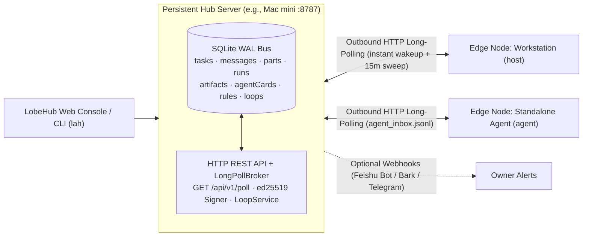

# lobe-a2a-hub

**A self-hosted, zero-external-dependency multi-agent orchestration hub with zero Feishu API quota limits** — preserving the A2A eight-state model, three-layer addressing (`Node` → `Worker` → `Skill`), instruction/data separation, and ed25519-signed approvals, while moving the shared bus to **SQLite WAL + outbound HTTP Long-Polling (`GET /api/v1/poll`)** with a built-in **LobeHub-style Web Console** and **LoopForge multi-stage SOP orchestration engine**.

[中文说明](README.md) · [Standard (Chinese)](docs/standard.md) · [Configuration & CLI](docs/configuration.md) · [Architecture](docs/architecture.md) · [Security Model](SECURITY.md) · [Changelog](CHANGELOG.md)

[](LICENSE)


---

## Why `lobe-a2a-hub`

Originally migrated from `lark-a2a-hub`, `lobe-a2a-hub` removes the mandatory Feishu/Lark Bitable API quota bottleneck while retaining every battle-tested reliability and security guarantee:

- **Self-Hosted Standalone Hub (`busType: "sqlite"`)**: Run `lah daemon --role hub` on a persistent server (such as a Mac mini or Linux VPS) backed by Node >= 24's built-in `node:sqlite` (WAL mode) and zero third-party npm dependencies (`dependencies: {}`).
- **Outbound HTTP Long-Polling Edge Nodes (`busType: "http"`)**: Remote machines, workstations, and standalone agents connect outbound via `GET /api/v1/poll` for sub-second wakeups when tasks, approvals, or answers arrive. Edge nodes never open inbound listening ports.
- **Built-in LobeHub-style Web Console** (`http://<hub>:8787`):
  - **Topology & Overview**: Live connected long-polling nodes, task state counters, and event health.
  - **Agent Hub Roster**: Three-layer (`Node` / `Worker` / `Skill`) capability matrix with `Receive_Mode` and `Dispatchable` status.
  - **A2A Conversation Stream**: Full `Messages` / `Parts` / `Runs` / `Artifacts` timeline, one-click ed25519-signed `Approve` / `Reject` actions for `auth-required`, and inline replies for `input-required`.
  - **LoopForge SOP Studio**: Launch, monitor, and cancel multi-stage closed-loop workflows directly from the UI.
- **LoopForge-style SOP Orchestration Engine (`LoopService`)**: Automate multi-stage pipelines (e.g. `plan → code → verify`) under a shared `Context_ID` with `Ref_Task_IDs`. Verify failures feed structured diagnostics (`retry` / `goto:<stage_id>` / `abort`) back to earlier stages, bounded by `Max_Iterations` and `HOP_LIMIT = 8`.
- **Optional Webhook Notifications & Feishu Compatibility**: Configure `notifications` in `node.json` to push alerts via Feishu custom group bots (no enterprise API quota), Bark, Telegram, or generic webhooks; existing Feishu Bitable setups still work via `busType: "feishu"`.

---

## Architecture Overview



### 1. Three-Level Addressing: `Node → Worker → Skill`

- **Node**: A physical or virtual machine (`mac-mini-hub`, `edge-node-1`).
- **Worker**: An agent runtime template configured under `workers` in `commands.json` (represented in `AgentCards` with `Skill_ID=agent`).
- **Skill**: A specialized skill targeting `workers: [...]` or a deterministic node script (`mode: json`).

### 2. Eight-State A2A Task Lifecycle

Tasks progress strictly across the eight A2A states: `submitted` → `working` ↔ `input-required` / `auth-required` → terminal (`completed` / `failed` / `canceled` / `rejected`). Terminal tasks are immutable; follow-up tasks share `Context_ID` and reference predecessors via `Ref_Task_IDs`.


---

## Quick Start

### Prerequisites

- **Node.js >= 24** (uses built-in `node:sqlite`, `node:http`, `node:crypto`, and global `fetch`; zero npm install needed).

```bash
git clone https://github.com/backtomyfuture/lobe-a2a-hub.git
cd lobe-a2a-hub
# Optional: expose `lah` / `lobe-hub` / `hub-node` globally
npm link
```

### 1) Start the Standalone Hub (e.g. on a Mac mini)

```bash
node bin/lah.mjs setup \
  --role hub \
  --bus sqlite \
  --node mac-mini-hub \
  --zone home \
  --prefix mm \
  --listen 0.0.0.0:8787 \
  --public-url http://127.0.0.1:8787 \
  --api-token "<YOUR_SECRET_TOKEN>" \
  --yes

node bin/lah.mjs doctor --role hub
node bin/lah.mjs daemon --role hub
```

Open **`http://127.0.0.1:8787`** and authenticate using your configured `LAH_API_TOKEN` (from `app.env` / `--api-token`; `--api-token` can be omitted for local `127.0.0.1` testing). Install user-level autostart with:

```bash
node bin/lah.mjs service --role hub
```

### 2) Connect a Remote Edge Node (Outbound Long-Polling Only)

Use the Hub's public key and `LAH_API_TOKEN` (see [`config/node.remote.example.json`](config/node.remote.example.json) and [`config/commands.example.json`](config/commands.example.json)):

```bash
node bin/lah.mjs setup \
  --role node \
  --bus http \
  --hub-url http://<HUB_IP>:8787 \
  --api-token "<HUB_API_TOKEN>" \
  --hub-key "<HUB_ED25519_PUBLIC_KEY>" \
  --node edge-node-1 \
  --zone office \
  --prefix e1 \
  --yes

node bin/lah.mjs doctor
node bin/lah.mjs daemon
```

---

## Common Commands (`lah` / `lobe-hub` / `hub-node`)

Configuration defaults to `~/.hub-node` (override with `--config <dir>` or `HUB_NODE_HOME`). See [Configuration & CLI](docs/configuration.md) for the complete reference.

| Area | Command | Purpose |
|---|---|---|
| **Setup & Ops** | `lah setup [--role node\|hub] [--bus sqlite\|http\|feishu]` | Initialize a standalone Hub, remote HTTP node, or Feishu Bitable node |
| | `lah daemon [--role node\|hub]` | Start the node or full Hub runtime (HTTP server, Web UI, Loops) |
| | `lah doctor [--role node\|hub]` | Read-only checks for config, `commands.json`, bus connectivity, autostart |
| | `lah service [--role node\|hub] [--remove]` | Install or remove user-level autostart (launchd / systemd / Windows) |
| | `lah inventory` | Inspect this node's AgentCards and task counts |
| | `lah reconcile` | Run a single sweep/reconciliation pass and exit |
| **Tasks & Debug** | `lah task create --to <node> [--worker <W>] [--cap <skill>] --text …` | Validate roster and create a task |
| | `lah present [--wait <sec>] [--task <ID>] [--pop]` | Read or wait for receipts in `present_queue.jsonl` |
| | `lah task reply --task <ID> --text …` | Reply to an `input-required` question and resume the task |
| | `lah task cancel --task <ID> [--text …]` | Cancel a non-terminal task |
| | `lah task why <ID> [--json]` | Reconstruct full timeline, acceptance summary, and local flight/outbox state |
| **LoopForge SOP** | `lah loop templates` | List built-in multi-stage SOP templates (e.g., `plan-code-verify`) |
| | `lah loop create --title … --goal … --to <node> [--template …]` | Launch an automated multi-stage closed loop |
| | `lah loop ls [--json]` / `lah loop show <Loop_ID>` | Inspect active and completed loops and stage history |
| | `lah loop cancel <Loop_ID> [--text …]` | Cancel a loop and its active task |
| **Local Scheduling & Inbox** | `lah schedule ls \| add \| rm \| enable \| disable` | Manage local `schedules.json` cron jobs |
| | `lah inbox [--pop] [--json]` / `lah inbox done \| ask \| fail \| auth` | Consume `agent_inbox.jsonl` and report results from standalone agents |

---

## Security Model

See [SECURITY.md](SECURITY.md) for full trust boundaries:

- **Edge nodes are outbound-only**: No open ports or reverse tunnels on worker nodes; only the Hub exposes its configured HTTP bind address with Bearer token protection (`GET /api/v1/health` exposes only minimal health metadata).
- **Instruction/data separation**: Executable templates, `cwd`, and `verify` live strictly in local `commands.json`. Task inputs are written to mode-600 `runs/<Task_ID>/input.json`; requests containing control keys (`command`, `cwd`, `context`, `agent`, `verify`, etc.) in params are rejected.
- **ed25519-signed approvals**: The Hub signs `auth_decision` records with `approval_key.pem` (`0600`) bound to `Task_ID` + `Status_Msg`. Nodes configured with `hubPublicKey` reject forged or unsigned decisions.
- **Secrets never committed**: `app.env`, `approval_key.pem`, `hub.db*`, `*_state.json`, and `runs/` are excluded in `.gitignore`.

---

## Testing

Zero external dependencies — run the full Node built-in `node:test` suite directly:

```bash
npm test
```

## License

[MIT](LICENSE)
