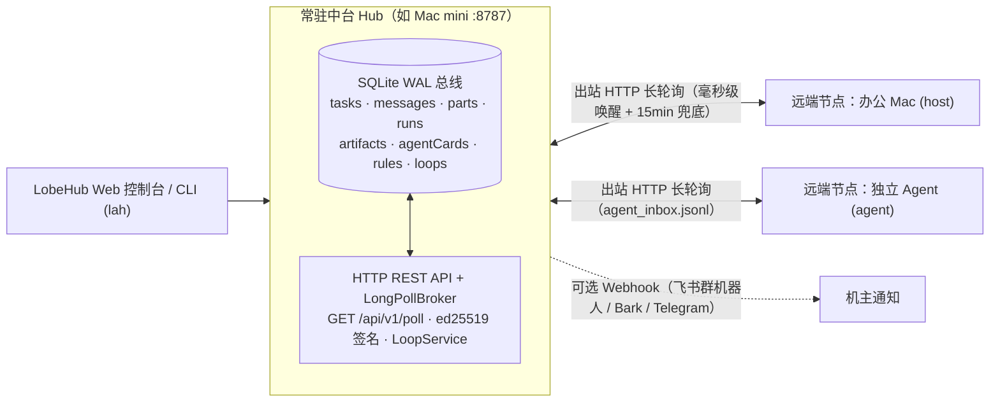

# lobe-a2a-hub

**零飞书 API 配额消耗、零外部运行时依赖的独立多 Agent 编排中台**——完整保留 A2A 八态协议、三层寻址（Node → Worker → Skill）、指令与数据分离和 ed25519 签名审批，并将总线升级为 **SQLite WAL + 出站 HTTP 长轮询（`GET /api/v1/poll`）**，内置 **LobeHub 风格可视化 Web 控制台**与 **LoopForge 多阶段 SOP 闭环编排引擎**，一台 Mac mini 或轻量服务器常驻即可调度全球接入的终端节点与独立 Agent。

[English](README.en.md) · [中台标准](docs/standard.md) · [配置与 CLI 手册](docs/configuration.md) · [架构设计](docs/architecture.md) · [安全模型](SECURITY.md) · [变更记录](CHANGELOG.md)

[](LICENSE)


---

## 为什么做 `lobe-a2a-hub`

原版 `lark-a2a-hub` 以飞书多维表格作共享总线，验证了 A2A 状态机与零入站边缘节点的可靠性，但受限于飞书应用 API 月度调用配额与平台依赖。`lobe-a2a-hub` 将这套生产级调度内核全面独立化：

- **常驻中枢（Mac mini / Linux / 云主机），免飞书配额**：`hub` 角色直接启动本地 SQLite WAL（Node >= 24 内置 `node:sqlite`）+ HTTP API 与静态控制台（默认监听 `0.0.0.0:8787`），无任何第三方 npm 运行时依赖（`dependencies: {}`）。
- **边缘节点纯出站 HTTP 长轮询**：远端机器（家用 Mac、办公电脑、GPU 工作站、Cloud Agent）通过 `GET /api/v1/poll` 维持出站长轮询，收到新任务、审批决策或问答答复时**毫秒级唤醒**；节点侧绝不开监听端口，无需公网 IP 或内网穿透。
- **LobeHub 风格内置 Web 控制台**：单文件零构建内嵌于中台（打开 `http://<hub>:8787` 即可使用）：
  - **总览与实时拓扑**：查看在线长轮询节点、排队/运行/阻塞任务与八态流转分布；
  - **Agent Hub 名片矩阵**：按 `Node / Worker / Skill` 三层展示各节点已登记能力、`Receive_Mode`、`Availability` 与可派发状态；
  - **A2A 对话流、在线审批与追问**：查看任务全历史（Tasks / Messages / Parts / Runs / Artifacts），对 `auth-required` 一键签名批准/驳回，对 `input-required` 直接在线回复续跑；
  - **LoopForge SOP 编排室**：可视化创建并追踪多阶段自动闭环（`plan → code → verify`），支持阶段失败重跑与回跳。
- **LoopForge 风格多阶段 SOP 闭环**：内置 `LoopService` 与 `lah loop` CLI，同一 `Context_ID` 下自动推进多阶段任务，借 `acceptance.mjs` 验收结果驱动 `retry` / `goto:<stage_id>` / `abort`，受 `Max_Iterations` 与 `HOP_LIMIT=8` 双重熔断保护。
- **可选多通道提醒 + 向下兼容飞书多维表格**：`node.json` 配置 `notifications` 后可向飞书普通群机器人 Webhook（不占应用 API 配额）、Bark、Telegram 或通用 Webhook 推送审批/问答/终态/陈旧告警；已有飞书多维表格环境仍可通过 `busType: "feishu"` 无缝运行。

---

## 架构与核心机制



### 1. 三层寻址：Node → Worker → Skill

- **Node**：接入中台的机器（如 `mac-mini-hub`、`edge-node-1`）。
- **Worker**：机器上的独立 Agent 执行体（在 `commands.json` 的 `workers` 中定义，名册里以 `Skill_ID=agent` 表示在册及其通用执行）。
- **Skill**：专长技能或确定性脚本（自带 `command` 由节点本尊执行；写 `workers: [...]` 则路由至指定 Worker 模板）。

### 2. 八态 A2A 任务生命周期

任务严格按 A2A 八态单向推进：`submitted` → `working` ↔ `input-required` / `auth-required` → 终态（`completed` / `failed` / `canceled` / `rejected`）。终态不可变，后续任务在同一 `Context_ID` 下新建并用 `Ref_Task_IDs` 引用前任。


---

## 快速上手

### 前置条件

- **Node.js >= 24**（内置 `node:sqlite` 与原生 `fetch`，无需安装外部运行时依赖）。

```bash
git clone https://github.com/backtomyfuture/lobe-a2a-hub.git
cd lobe-a2a-hub
# 如需全局注册 `lah` / `lobe-hub` / `hub-node` 命令（可选）：
npm link
```

### 1) 在常驻主机（如 Mac mini）启动独立中台 Hub

非交互快速初始化（SQLite 总线 + 生成 `approval_key.pem` ed25519 签名密钥；若对外暴露建议同时传入 `--api-token`）：

```bash
node bin/lah.mjs setup \
  --role hub \
  --bus sqlite \
  --node mac-mini-hub \
  --zone home \
  --prefix mm \
  --listen 0.0.0.0:8787 \
  --public-url http://127.0.0.1:8787 \
  --api-token "<YOUR_SECRET_TOKEN>" \
  --yes

# 自检配置与数据库
node bin/lah.mjs doctor --role hub

# 启动中台（同时运行 Hub Kernel、HTTP 服务、LongPollBroker、LoopService 与 Web 控制台）
node bin/lah.mjs daemon --role hub
```

启动后访问 **`http://127.0.0.1:8787`**（或你的内网/Tailscale IP `:8787`），如设置了 `--api-token`，在控制台填入对应 Token 即可管理节点、派发任务与审批（仅绑定 `127.0.0.1` 本地调试时也可省略 `--api-token`）。安装开机自启：

```bash
node bin/lah.mjs service --role hub
```

### 2) 在其他机器接入远端节点（仅出站长轮询）

把 Hub 的 `hubPublicKey` 与 `LAH_API_TOKEN` 配到远端节点（参考样例 [`config/node.remote.example.json`](config/node.remote.example.json) 与 [`config/commands.example.json`](config/commands.example.json)）：

```bash
node bin/lah.mjs setup \
  --role node \
  --bus http \
  --hub-url http://<HUB_IP>:8787 \
  --api-token "<HUB_API_TOKEN>" \
  --hub-key "<HUB_ED25519_PUBLIC_KEY>" \
  --node edge-node-1 \
  --zone office \
  --prefix e1 \
  --yes

node bin/lah.mjs doctor
node bin/lah.mjs daemon
```

远端节点**不监听任何端口**，仅通过出站 HTTP 长轮询连接中台收单、续跑与回报结果。

---

## 常用命令（CLI 简称 `lah` / `lobe-hub` / `hub-node`）

默认配置目录为 `~/.hub-node`（可通过 `--config <dir>` 或环境变量 `HUB_NODE_HOME` 指定）。完整参数见 [配置与 CLI 手册](docs/configuration.md)。

| 分类 | 命令 | 用途 |
|---|---|---|
| **初始化与运维** | `lah setup [--role node\|hub] [--bus sqlite\|http\|feishu]` | 向导：初始化 SQLite 中台、远端 HTTP 节点或飞书多维表格节点 |
| | `lah daemon [--role node\|hub]` | 启动节点或 Hub 全功能守护进程（含 HTTP 网关、Web 控制台、Loop 引擎） |
| | `lah doctor [--role node\|hub]` | 只读自检：配置、`commands.json` 能力、总线/Hub 连通性、自启状态 |
| | `lah service [--role node\|hub] [--remove]` | 注册或卸载用户级开机自启（launchd / systemd / Windows 任务计划） |
| | `lah inventory` | 只读盘点本节点名片与按状态汇总的任务 |
| | `lah reconcile` | 单次对账巡检后退出 |
| **任务与呈递** | `lah task create --to <node> [--worker <W>] [--cap <skill>] --text …` | 校验名册并向指定节点/Worker 派单 |
| | `lah present [--wait <秒>] [--task <ID>] [--pop]` | 读取或阻塞等待本机 `present_queue.jsonl` 结果与提问 |
| | `lah task reply --task <ID> --text …` | 回复 `input-required` 追问并恢复原任务执行 |
| | `lah task cancel --task <ID> [--text …]` | 撤回未终态任务 |
| | `lah task why <ID> [--json]` | 只读排障：完整时间线、验收结论与本地在途/重投账本 |
| **LoopForge SOP** | `lah loop templates` | 列出内置多阶段 SOP 模板（如 `plan-code-verify`） |
| | `lah loop create --title … --goal … --to <node> [--template …]` | 启动多阶段自动闭环并追踪验收反馈回跳 |
| | `lah loop ls [--json]` / `lah loop show <Loop_ID>` | 查看全网 SOP 闭环进度、迭代轮次与历史阶段记录 |
| | `lah loop cancel <Loop_ID> [--text …]` | 取消闭环及其当前在途子任务 |
| **本地调度与 Agent** | `lah schedule ls \| add \| rm \| enable \| disable` | 管理节点本地 `schedules.json` 定时任务 |
| | `lah inbox [--pop] [--json]` / `lah inbox done \| ask \| fail \| auth` | 独立 Agent 节点读取收件箱与回报状态 |

---

## 安全红线与不变式

完整信任边界见 [SECURITY.md](SECURITY.md) 与 [docs/standard.md](docs/standard.md)：

- **节点侧零入站**：边缘执行节点永不开监听端口；仅中台 Hub 监听配置端口并支持 Bearer API Token 鉴权（`GET /api/v1/health` 仅暴露最低限度的健康状态与序号）。
- **指令与数据严格分离**：可执行命令、`cwd`、`verify` 只能来自节点本地 `commands.json`；任务指令与参数写入 `0600` 权限的 `runs/<Task_ID>/input.json`，请求参数含 `command` / `cwd` / `context` / `agent` / `verify` 等控制键时直接拒收。
- **ed25519 审批签名**：Hub 使用本地 `0600` 私钥 `approval_key.pem` 为每条 `auth_decision` 签名并绑定 `Task_ID` 与 `Status_Msg`，配置了 `hubPublicKey` 的节点会拒绝伪造或未签名的审批决定。
- **凭据不入库、不上总线、不进日志**：`app.env`、`approval_key.pem`、`hub.db*`、`*_state.json`、`runs/` 均已加入 `.gitignore`。

---

## 文档导航

| 文档 | 内容 |
|---|---|
| [docs/configuration.md](docs/configuration.md) | 配置目录、`node.json` / `commands.json` / `schedules.json`、独立中台与 Loop 配置、CLI 速查 |
| [docs/architecture.md](docs/architecture.md) | 架构分层、SQLite/HTTP 长轮询传输、Web 控制台、Loop 引擎与故障模型 |
| [docs/standard.md](docs/standard.md) | **中台标准规范**：表模型、A2A 八态机、审批与验收协议 |
| [docs/hub-integration.md](docs/hub-integration.md) | Hub 职责、建单约束、结果呈递与审批流 |
| [docs/agent-templates.md](docs/agent-templates.md) | 无头 CLI Agent 模板与权限配置注意点 |
| [SECURITY.md](SECURITY.md) | 信任模型与签名审批边界 |
| [CHANGELOG.md](CHANGELOG.md) | 版本变更记录 |

## 开发与测试

零外部依赖，直接使用 Node >= 24 内置测试运行器（`node:test`）：

```bash
npm test
```

## License

[MIT](LICENSE)
