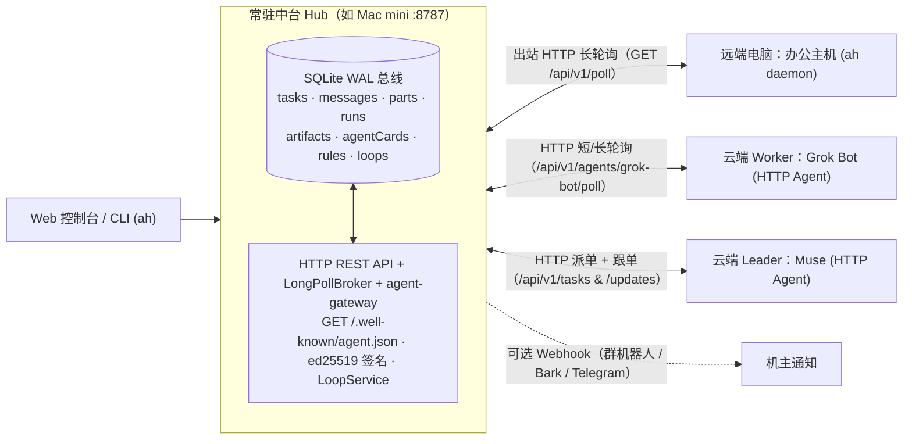

# a2a-hub

**零外部运行时依赖的独立多 Agent 编排中台**——基于 **A2A 八态数据模型**、**三层寻址（Node → Worker → Skill）**、**指令与数据分离**和 **ed25519 签名审批**，统一采用 **SQLite WAL + HTTP 网关（出站长轮询 + 外部 HTTP Agent 接入）**，内置 **可视化 Web 控制台**与 **LoopForge 多阶段 SOP 闭环编排引擎**，一台 Mac mini 或轻量服务器常驻即可调度本机 Agent、远程电脑节点以及纯 HTTP 云端 Agent（如 **Muse**、**Grok Bot**）。

[English](README.en.md) · [中台标准](docs/standard.md) · [配置与 CLI 手册](docs/configuration.md) · [外部 HTTP Agent 手册](docs/protocol-node-runbook.md) · [架构设计](docs/architecture.md) · [安全模型](SECURITY.md) · [变更记录](CHANGELOG.md)

[](LICENSE)


---

## 为什么做 `a2a-hub`

- **常驻中枢（Mac mini / Linux / 云主机），免外部数据库**：`hub` 角色直接启动本地 SQLite WAL（Node >= 24 内置 `node:sqlite`）+ HTTP API 与静态控制台（默认监听 `0.0.0.0:8787`），无任何第三方 npm 运行时依赖（`dependencies: {}`）。
- **两类终端统一走 HTTP，节点零入站端口**：
  - **宿主守护节点（`ah join`）**：远端电脑（办公 Mac、Linux 工作站、GPU 服务器等）运行轻量守护进程 `ah daemon`，通过 `GET /api/v1/poll` 维持纯出站长轮询，收到新任务、审批或追问答复时毫秒级唤醒并拉起本机 CLI/脚本。
  - **纯 HTTP 外部 Agent（Muse / Grok Bot 等）**：无常驻进程。机主在控制台签发分 Agent Token（不是机主自己的 `AH_API_TOKEN`）。`GET /.well-known/agent.json` 免鉴权；`/api/v1/skills*` 与其余接口要这把 Token。定时器跑检查脚本（worker / hybrid 每 2 分钟，leader 每 5 分钟）：`IDLE` 结束，`WORK` 再 `poll?timeout=0` 或 `updates?new=1`。跑不了脚本时回退为 worker 每 10 分钟、leader 每 15 分钟。每次唤醒都没有上一轮上下文。
- **内置 Web 控制台**：单文件零构建内嵌于中台（打开 `http://<hub>:8787`，用机主 Token）：
  - **待我处理**：首页集中待审批、待答复和需要看一眼的任务；
  - **Agent**：按节点分组，接纳名片、改显示名、重新生成或吊销 Token；
  - **派单**：大白话表单，不必先填协议字段；
  - **添加 Agent**：三步向导（接入类型、名字与角色、密钥与接入指引）。云端 HTTP 会签发一把只显示一次的分 Agent Token；
  - **任务与 SOP**：任务详情里在线 ed25519 审批、答复追问，以及 LoopForge 编排室。
- **LoopForge 风格多阶段 SOP 闭环**：内置 `LoopService` 与 `ah loop` CLI，同一 `Context_ID` 下自动推进多阶段任务，借 `acceptance.mjs` 验收结果驱动 `retry` / `goto:<stage_id>` / `abort`，受 `Max_Iterations` 与 `HOP_LIMIT=8` 双重熔断保护。
- **可选多通道提醒**：`node.json` 配置 `notifications` 后可向飞书群机器人 Webhook（可选通知渠道）、Bark、Telegram 或通用 Webhook 推送审批/问答/终态/陈旧告警。

---

## 架构与核心机制



### 1. 三层寻址：Node → Worker → Skill

- **Node**：接入中台的机器（如 `mac-mini-hub`、`edge-node-1`）。
- **Worker**：机器上的独立 Agent 执行体（在 `commands.json` 的 `workers` 中定义，名册里以 `Skill_ID=agent` 表示在册及其通用执行）。
- **Skill**：专长技能或确定性脚本（自带 `command` 由节点本尊执行；写 `workers: [...]` 则路由至指定 Worker 模板）。

### 2. 八态 A2A 任务生命周期

任务严格按 A2A 八态单向推进：`submitted` → `working` ↔ `input-required` / `auth-required` → 终态（`completed` / `failed` / `canceled` / `rejected`）。终态不可变，后续任务在同一 `Context_ID` 下新建并用 `Ref_Task_IDs` 引用前任。


---

## 快速上手

### 前置条件

- **Node.js >= 24**（内置 `node:sqlite` 与原生 `fetch`，无需安装外部运行时依赖）。

### 方式 A：一行命令全新安装并启动（推荐）

**1) 在常驻主机（如 Mac mini / Linux）一行启动 Hub（自动生成密钥与 Token、开启 HTTP 服务并注册后台自启）：**

```bash
curl -fsSL https://raw.githubusercontent.com/backtomyfuture/a2a-hub/main/install.sh | sh -s -- --hub
```

安装完成后终端会直接输出：
- 带免密参数的 Web 控制台地址：`http://<你的IP>:8787/?token=...`（首次打开自动写入浏览器本地存储并清洗地址栏）
- 供其他机器复制即连的一行接入命令（含 Token，默认 0.0.0.0:8787 监听；加 `--no-service` 可仅在前台运行）。

**2) 在其他机器接入远端执行节点（仅出站长轮询，不开放任何入站端口）：**

```bash
# macOS / Linux：
curl -fsSL https://raw.githubusercontent.com/backtomyfuture/a2a-hub/main/install.sh | sh -s -- --join "http://<AH_API_TOKEN>@<HUB_IP>:8787"

# Windows PowerShell：
$env:AH_JOIN = "http://<AH_API_TOKEN>@<HUB_IP>:8787"; irm https://raw.githubusercontent.com/backtomyfuture/a2a-hub/main/install.ps1 | iex
```

`--join` 会自动将 Token 写入 `0600` 权限的 `app.env`（不进入 `node.json`）、从 `GET /api/v1/health` 同步 `hubPublicKey`，并注册后台长轮询服务。

### 方式 B：源码目录一键运行

如果你已经克隆了仓库：

```bash
git clone https://github.com/backtomyfuture/a2a-hub.git
cd a2a-hub
# 如需全局注册 `ah` / `a2a-hub` / `ahub` 命令（可选）：
npm link

# 1) 在 Mac mini / 主机一行启动 Hub（加 --service 可顺便注册开机自启）：
node bin/ah.mjs up

# 2) 在其他机器一行接入节点（加 --service 注册开机自启）：
node bin/ah.mjs join http://<AH_API_TOKEN>@<HUB_IP>:8787
```

### 方式 C：纯 HTTP 外部 Agent 接入（Muse / Grok Bot，无需守护进程）

云端或定时唤醒的纯 Agent 不装守护进程。先在 Web 控制台「添加 Agent」拿到该节点的分 Agent Token（明文只出现一次）。自发现地址 `GET http://<HUB_IP>:8787/.well-known/agent.json` 免鉴权；拉取 Skill（`GET /api/v1/skills/a2a-leader` 或 `a2a-worker`）和其他接口都要带这把 Token。下面用 `<AGENT_TOKEN>` 表示它，不要填机主的 `AH_API_TOKEN`。

```bash
# 1) 注册为 Leader（如 Muse：每 15 分钟跟单）或 Worker（如 Grok Bot：每 10 分钟取单）
curl -X POST http://<HUB_IP>:8787/api/v1/agents/register \
  -H "Authorization: Bearer <AGENT_TOKEN>" -H "Content-Type: application/json" \
  -d '{"node":"muse","role":"leader","kind":"agent","receive_mode":"http-poll"}'

curl -X POST http://<HUB_IP>:8787/api/v1/agents/register \
  -H "Authorization: Bearer <AGENT_TOKEN>" -H "Content-Type: application/json" \
  -d '{"node":"grok-bot","role":"worker","kind":"agent","receive_mode":"http-poll","caps":[{"skill_id":"research","skill_name":"Grok 搜索"}]}'

# 2) Muse 派单，并用 new=1 只拉新变化（终态增量 + 仍待处理的提问/审批）
curl -X POST http://<HUB_IP>:8787/api/v1/tasks \
  -H "Authorization: Bearer <AGENT_TOKEN>" -H "Content-Type: application/json" \
  -d '{"from":"muse","to":"grok-bot","cap":"research","text":"调研 A2A 网关最佳方案"}'
curl -H "Authorization: Bearer <AGENT_TOKEN>" \
  "http://<HUB_IP>:8787/api/v1/agents/muse/updates?new=1"

# 3) Grok Bot 短轮询取单 -> 同一次运行内认领并交付
curl -H "Authorization: Bearer <AGENT_TOKEN>" \
  "http://<HUB_IP>:8787/api/v1/agents/grok-bot/poll?timeout=0"
curl -X POST "http://<HUB_IP>:8787/api/v1/tasks/<TASK_ID>/claim" \
  -H "Authorization: Bearer <AGENT_TOKEN>" -H "Content-Type: application/json" -d '{"node":"grok-bot"}'
curl -X POST "http://<HUB_IP>:8787/api/v1/tasks/<TASK_ID>/complete" \
  -H "Authorization: Bearer <AGENT_TOKEN>" -H "Content-Type: application/json" \
  -d '{"node":"grok-bot","text":"已完成调研","artifact":"https://example.com/report.md"}'
```

更多接口说明见 [外部 HTTP Agent 手册](docs/protocol-node-runbook.md)。

<details>
<summary>高级用法：手动分步 setup / 自定义参数 / 仅本地调试</summary>

1) 初始化独立中台 Hub：

```bash
node bin/ah.mjs setup \
  --role hub \
  --bus sqlite \
  --node mac-mini-hub \
  --zone home \
  --prefix mm \
  --listen 0.0.0.0:8787 \
  --public-url http://127.0.0.1:8787 \
  --api-token "<YOUR_SECRET_TOKEN>" \
  --yes

node bin/ah.mjs doctor --role hub
node bin/ah.mjs daemon --role hub
node bin/ah.mjs service --role hub
```

2) 手动接入远端 HTTP 长轮询节点（参考样例 [`config/node.remote.example.json`](config/node.remote.example.json) 与 [`config/commands.example.json`](config/commands.example.json)）：

```bash
node bin/ah.mjs setup \
  --role node \
  --bus http \
  --hub-url http://<HUB_IP>:8787 \
  --api-token "<AH_API_TOKEN>" \
  --hub-key "<HUB_ED25519_PUBLIC_KEY>" \
  --node edge-node-1 \
  --zone office \
  --prefix e1 \
  --yes

node bin/ah.mjs doctor
node bin/ah.mjs daemon
```

</details>

---

## Agent Skill 分工（2×2 四象限）

按「控制发单 / 认领执行」与「本地有 `ah` CLI / 无 CLI 纯 HTTP」拆分为 4 套互不干扰的 Skill 模板，`setup` / `update` 只会向本机 `~/.agents/skills/` 安装当前机器所需的 CLI Skill：

| 角色 \ 运行形态 | 装有 `ah` CLI（本地安装） | 无 CLI 纯 HTTP（云端 / 独立 Agent） |
|---|---|---|
| **控制端 / Leader**（查名册、派单、SOP 编排、收结果） | [`skills/ah/SKILL.md`](skills/ah/SKILL.md) | [`skills/a2a-leader/SKILL.md`](skills/a2a-leader/SKILL.md)（`GET /api/v1/skills/a2a-leader`，需鉴权） |
| **执行端 / Worker**（取单、提问、审批、回执） | [`skills/ah-inbox/SKILL.md`](skills/ah-inbox/SKILL.md)（仅 `kind=agent` 自动安装） | [`skills/a2a-worker/SKILL.md`](skills/a2a-worker/SKILL.md)（`GET /api/v1/skills/a2a-worker`，需鉴权） |

---

## 常用命令（CLI 简称 `ah`，别名 `a2a-hub` / `ahub`）

默认配置目录为 `~/.a2a-hub`（程序本体位于 `~/.a2a-hub/app/`，可通过 `--config <dir>` 或环境变量 `AH_HOME` 指定）。完整参数见 [配置与 CLI 手册](docs/configuration.md)。

| 分类 | 命令 | 用途 |
|---|---|---|
| **一键部署** | `ah up [--listen …] [--service] [--no-daemon]` | 一键初始化 SQLite Hub（自动生成 Token 与签名密钥）并启动 |
| | `ah join <hub_url> [--node …] [--service] [--no-daemon]` | 一键抽离凭据、拉取 Hub 公钥并启动出站长轮询节点 |
| **初始化与运维** | `ah setup [--role node\|hub] [--bus sqlite\|http]` | 向导：初始化 SQLite 中台或远端 HTTP 长轮询节点 |
| | `ah daemon [--role node\|hub]` | 启动节点或 Hub 全功能守护进程（含 HTTP 网关、Web 控制台、Loop 引擎） |
| | `ah doctor [--role node\|hub]` | 只读自检：配置、`commands.json` 能力、总线/Hub 连通性、自启状态 |
| | `ah service [--role node\|hub] [--remove]` | 注册或卸载用户级开机自启（launchd / systemd / Windows 任务计划） |
| | `ah inventory` | 只读盘点本节点名片与按状态汇总的任务 |
| | `ah reconcile` | 单次对账巡检后退出 |
| **任务与呈递** | `ah task create --to <node> [--worker <W>] [--cap <skill>] --text …` | 校验名册并向指定节点/Worker 派单 |
| | `ah present [--wait <秒>] [--task <ID>] [--pop]` | 读取或阻塞等待本机 `present_queue.jsonl` 结果与提问 |
| | `ah task reply --task <ID> --text …` | 回复 `input-required` 追问并恢复原任务执行 |
| | `ah task cancel --task <ID> [--text …]` | 撤回未终态任务 |
| | `ah task why <ID> [--json]` | 只读排障：完整时间线、验收结论与本地在途/重投账本 |
| **LoopForge SOP** | `ah loop templates` | 列出内置多阶段 SOP 模板（如 `plan-code-verify`） |
| | `ah loop create --title … --goal … --to <node> [--template …]` | 启动多阶段自动闭环并追踪验收反馈回跳 |
| | `ah loop ls [--json]` / `ah loop show <Loop_ID>` | 查看全网 SOP 闭环进度、迭代轮次与历史阶段记录 |
| | `ah loop cancel <Loop_ID> [--text …]` | 取消闭环及其当前在途子任务 |
| **本地调度与 Agent** | `ah schedule ls \| add \| rm \| enable \| disable` | 管理节点本地 `schedules.json` 定时任务 |
| | `ah inbox [--pop] [--json]` / `ah inbox done \| ask \| fail \| auth` | 独立 Agent 节点读取收件箱与回报状态 |

---

## 安全红线与不变式

完整信任边界见 [SECURITY.md](SECURITY.md) 与 [docs/standard.md](docs/standard.md)：

- **节点侧零入站**：边缘执行节点永不开监听端口；仅中台 Hub 监听配置端口并支持 Bearer API Token 鉴权（`GET /api/v1/health` 仅暴露最低限度的健康状态与序号）。
- **指令与数据严格分离**：可执行命令、`cwd`、`verify` 只能来自节点本地 `commands.json`；任务指令与参数写入 `0600` 权限的 `runs/<Task_ID>/input.json`，请求参数含 `command` / `cwd` / `context` / `agent` / `verify` 等控制键时直接拒收。
- **ed25519 审批签名**：Hub 使用本地 `0600` 私钥 `approval_key.pem` 为每条 `auth_decision` 签名并绑定 `Task_ID` 与 `Status_Msg`，配置了 `hubPublicKey` 的节点会拒绝伪造或未签名的审批决定。
- **凭据不入库、不上总线、不进日志**：`app.env`、`approval_key.pem`、`hub.db*`、`*_state.json`、`runs/` 均已加入 `.gitignore`。

---

## 文档导航

| 文档 | 内容 |
|---|---|
| [docs/configuration.md](docs/configuration.md) | 配置目录、`node.json` / `commands.json` / `schedules.json`、独立中台与 Loop 配置、CLI 速查 |
| [docs/architecture.md](docs/architecture.md) | 架构分层、SQLite/HTTP 长轮询传输、Web 控制台、Loop 引擎与故障模型 |
| [docs/standard.md](docs/standard.md) | **中台标准规范**：表模型、A2A 八态机、审批与验收协议 |
| [docs/hub-integration.md](docs/hub-integration.md) | Hub 职责、建单约束、结果呈递与审批流 |
| [docs/agent-templates.md](docs/agent-templates.md) | 无头 CLI Agent 模板与权限配置注意点 |
| [SECURITY.md](SECURITY.md) | 信任模型与签名审批边界 |
| [CHANGELOG.md](CHANGELOG.md) | 版本变更记录 |

## 开发与测试

零外部依赖，直接使用 Node >= 24 内置测试运行器（`node:test`）：

```bash
npm test
```

## License

[MIT](LICENSE)
