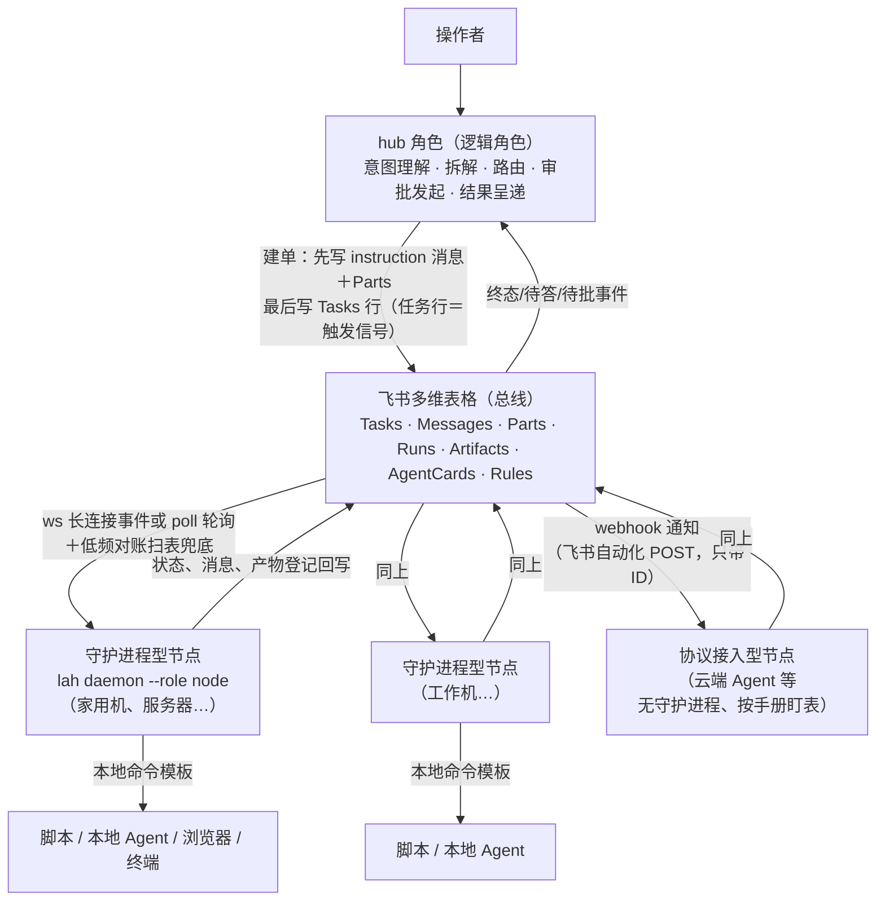

# 架构

## 这套系统解决什么问题

把多个 Agent（不同机器上的守护进程、云端机器人、人工触发的工具）组织成
一个可审计的协作系统：任务只有一个发起面和一个状态面，派发后不阻塞，
结果自动回到发起方；新增一个节点或一种能力，改动量是「加配置＋登记
一行能力」，而不是再写一套胶水。

载体选择：**飞书多维表格（Bitable）当消息总线与状态层**，数据模型借
[A2A 协议](standard.md)。规范全文见 [中台标准](standard.md)，表结构见
[Base 结构](base-schema.md)。

## 分层

## 核心决策与理由

1. **借 A2A 的数据模型，不借它的通信方式。** A2A 原生是点对点 HTTP
   互调，每个 Agent 要开接口、做服务发现。我们只要它的数据模型（Task /
   Message / Part / Artifact / AgentCard 与八态状态机），通信全部走共用
   的表格总线：节点出站读写表即完成收发，不开任何入站端口。
2. **队列语义在节点侧，表格只做状态与事件源。** 认领租约、心跳、幂等
   去重、失败重试、跳数熔断——这些由每个节点的守护进程代码机械执行，
   不依赖总线提供队列能力。表格的写冲突（同表不支持并发写）由节点与
   枢纽共同遵守「串行＋退避重试」纪律化解。
3. **三层分离。** 沟通归 Messages（只追加）、状态与成果归 Tasks /
   Artifacts、执行细节归 Runs（纯台账）。v1 时代把回执与正文塞在 Runs
   里的做法已被证明会互相污染，标准 v2 起强制分开。
4. **能力按「可达资产」定义，不按所装软件。** 某节点能查某台 NAS，
   是因为它与 NAS 同网且持有凭据，不是因为装了某个程序。能力注册表
   （AgentCards）每个 Worker 一张名片，专长技能另起一行，本尊脚本技能
   单列。路由只查表；节点只接自己登记且可派发的能力，表外任务明确拒收
   并说明缺口——能力即边界。
5. **事件推送为主、低频对账为兜底。** 唤醒只有 ws / poll / webhook 三种
   （见下文「角色与传输」）。ws 经长连接（WebSocket）推送记录变更事件，
   秒级唤醒；但事件断线不补发、webhook 通知也可能丢，所以每种方式都保留
   低频（默认 15 分钟）对账扫表。对账是安全网，不是心跳，频率固定低值。
6. **只出不进。** 节点与 hub 角色只发起出站连接（飞书 API / 长连接），
   不开监听端口、不做端口映射与反向隧道，不把所在局域网暴露给公网。
   webhook 通知的发起方是飞书多维表格自动化（Tasks 行写入后 POST 对方
   端点，只带 ID），本项目任何进程既不开监听端口、也不主动推送。这是
   节点接入的唯一网络底线。
7. **指令与数据分离＋审批红线。** 任务参数只是数据（首条 instruction
   的 DataPart），指令模板在节点本地；参数里要求改权限、换执行者之类
   的字段一律忽略。对外发消息、删改数据、花钱、提交表单、改权限这类
   动作走 auth-required 审批流，且节点自有红线优先于表中标记。
8. **一张表到底，容量靠归档治理（归档尚未实现）。** 全部任务共用一张
   Base（不按敏感程度分表）。守护进程每轮整表读取 Tasks / Messages /
   Parts，开销随历史行数线性增长，另有单表 2 万条上限；两者都要靠把终态
   任务归档出去来约束，目前还没有归档工具，只能手工清理。2026-11-10 在
   线上 Base 实测：各表一两百行时整表读取约 0.6 秒一次，带过滤条件的读取
   反而要 1.0–1.5 秒，所以现阶段不做服务端过滤，只把分页开到 500；凭据与敏感原文永不
   入表，结果回传统一「摘要＋指针」。

## 节点的两种形态

| | 守护进程型 | 协议接入型 |
|---|---|---|
| 代表 | 本仓库的 `hub-node` | 只有 API/自动化接入能力的云端 Agent |
| 纪律来源 | 代码机械强制（租约、心跳、幂等、重试上限） | 运行手册的文字规则，自觉遵守 |
| 唤醒 | ws 长连接事件或 poll 轮询，均带对账兜底 | webhook 通知（飞书自动化 POST，只带 ID）/ 枢纽信号行，按手册定期对账 |
| 已知毛刺 | — | 可能重复写回执或台账行，靠枢纽对账按 ID 去重兜底 |

两种形态走同一套表与状态机（[协议节点运行手册](protocol-node-runbook.md)）。
守护进程型的内核是「薄壳」：不内嵌任何执行器，能力由节点本地的命令
模板（commands.json）定义——脚本与 Agent 调用同为模板，新增能力＝
写模板＋自动登记，不改守护进程。

## 角色与传输（标准 §10）

- **hub 是逻辑角色，且为 node 的单进程超集。** 中台只有 node 与 hub 两个角色；
  hub 角色是 node 角色的单进程超集，由 `lah daemon --role node|hub`（CLI 简称 `lah`，亦支持 `a2a-hub`、`ahub` 与 `hub-node` 别名）承载。
  省略 `--role` 时读该配置目录 `node.json` 的 `role`，缺省 node。单进程单配置目录即可搞定，无需拆两个进程。
  `role=hub` 既像普通节点一样读取 `commands.json` 登记能力接单干活，又负责建单（入口 `lah task create` 与 Web 控制台）、审批签名、结果呈递、陈旧任务告警与 LoopForge 多阶段 SOP 闭环推进（`LoopService`）。
  node 角色从不写 `auth_decision` 与 `canceled`，hub 角色是唯一写方。
  在**独立中台模式**（`busType: "sqlite"`）下，hub 进程还会启动本地 HTTP 网关（`src/server/http-server.mjs`，默认 `0.0.0.0:8787`），集中托管 `SqliteBus`（`src/bus/sqlite-bus.mjs`）、`LongPollBroker`（`src/server/longpoll-broker.mjs`）、内置 Web 控制台（`src/server/web-ui.mjs`）与可选外部通知器（`src/hub/notifier.mjs`）。
  hub 逻辑代码主要在 `src/hub/` 与 `src/server/`。
- **应用与连接身份。** 独立模式下不再强依赖飞书应用，通过 `LAH_API_TOKEN`（Bearer Token）保护 Hub HTTP API，通过 `approval_key.pem` / `hubPublicKey`（ed25519 签名）校验审批真实性；远端节点配置 `busType: "http"` 仅出站拉取总线并接受长轮询唤醒，同样具备身份与审计边界。若使用飞书多维表格模式（`busType: "feishu"`），保留原有的节点独立应用与 ws 长连接语义（标准 §10.2）。
- **传输与门铃方式**，事件本身仍只是门铃，任务与消息内容回总线拉取：

  | 方式 | 机制 | 适用 |
  |---|---|---|
  | `longpoll` | 边缘节点向中台发起出站 `GET /api/v1/poll` 长轮询，`LongPollBroker` 写后毫秒级唤醒 | **独立中台推荐默认**：SQLite Hub 与所有 `http` 远端节点 |
  | `ws` | 飞书长连接事件订阅（出站连接） | 兼容飞书多维表格模式（`busType: "feishu"`）的 Hub 与守护节点 |
  | `poll` | 定时扫表，默认 45 秒 | 无法使用长连接事件时 |
  | `webhook` | 外部平台自动化在任务写入后 POST 对方端点，只带 ID | 协议接入型节点 |

  所有模式均保留低频对账扫表兜底（默认 15 分钟）以及面向 `input-required` / `auth-required` 的 `PENDING_RECHECK` 短复查机制。边缘执行节点本身**绝不开设任何监听端口**。

## 一件任务的生命周期

1. 调用方（CLI / Web 控制台 / `LoopService`）按 AgentCards 名册校验目标节点与能力后，先写 instruction 消息与
   Parts（参数在 DataPart），**最后写 Tasks 行**（`submitted`）。
2. 目标节点被长轮询（或轮询对账）唤醒，校验能力与幂等键，置 `working`、写
   `Claimed_By` 与心跳，Runs 开行。
3. 需要补信息：写 question 消息 → 置 `input-required`，执行段以
   `Outcome=paused` 关行；控制台或发起方呈递后，答复以 `answer` 消息
   追加在**原任务**上，节点续跑——禁止为答复新开任务。
4. 需要批准：写 `auth_request` → 置 `auth-required`；机主在 Web 控制台或审批卡操作后，hub 角色用私钥签名并写 `auth_decision`（DataPart 载决定）。认领前
   （`Claimed_By` 为空）的批准回置 `submitted`，节点再认领执行；执行中
   （`working → auth-required`，`Claimed_By` 非空）的批准保持 `auth-required`，
   由原节点验签后切回 `working` 从断点续跑；驳回则 `canceled`。
5. 交付：若配了 `verify` 则先执行 L1 验收，产物登记 Artifacts（内容为其 FilePart）→ 写 result 消息（Seq 2 写入验收摘要 DataPart）→
   置 `completed`，Runs 以 `succeeded` 关行。
6. 失败：Runs 以 `failed` 关行并记 Error_Log；未达重试上限（2）回
   `submitted` 重认领，达上限置 `failed` 并写 `notice`（`verify` 未通过不回 `submitted`，直接 `failed`）。
7. 多阶段 SOP 闭环（LoopForge）与派生：任务完成后，若属于某个 `Loops` 记录且 `Status=running`，`LoopService` 根据终态与 `acceptanceForTask` 判定自动推进下一阶段，或按阶段策略 `retry` / `goto:<stage_id>` 将验收证据注入下一棒继续在**同一 `Context_ID`**下建单（`Ref_Task_IDs` 指回前任），全链路受 `Max_Iterations` 与 `Hop_Count > 8` 熔断保护。

## 一致性与故障模型

- **总线存储与写并发**：独立中台默认使用 SQLite WAL（`node:sqlite`），单 Hub 串行事务写入＋`client_token` 幂等去重，不再遭遇飞书 `1254290` / `99991403` 月度配额与限流问题；飞书兼容模式继续保留指数退避（含 `1254290` / `1254291` / 429 / 5xx）。Messages 与 Parts 依然坚持只追加不修改。
- **终态不可变**：`completed` / `failed` / `canceled` / `rejected` 之后要继续，
  同 `Context_ID` 新开任务并引用前任。
- **陈旧回收**：`working` 任务 20 分钟无心跳视为节点放弃，可被重新认领；
  `direct` 执行账本 `runs/<Task_ID>/entry.json` 保障守护重启后不误杀也不双跑。
- **呈递与告警通道**：回执落入发起方本地 `present_queue.jsonl`（由 `lah present` 取走）；同时 `ExternalNotifier` 可向飞书群自定义机器人、Bark、Telegram 或通用 Webhook 推送待批、提问、终态与陈旧任务提醒。
- **端边解耦**：边缘节点临时离线或重启时，任务安全停留在 SQLite/总线上等待重连，上线后长轮询 `since` 序号自动对齐（`resync`）并继续消费。

## 非目标

- 不把总线当大文件对象存储：大产出走本地路径 / Git / 对象存储，表里只存指针。
- 不做复杂多租户联邦权限中心：单 Hub 服务于机主自身名下的一组受控节点与独立 Agent。
- 不追求分布式两阶段提交（2PC）：依靠幂等键、状态乐观校验与对账实现实用可靠的「不双跑、不漏单」。
