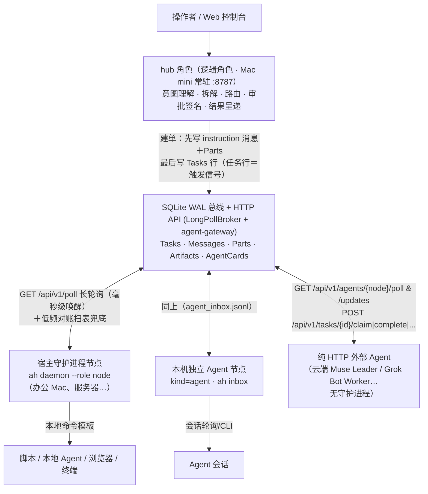
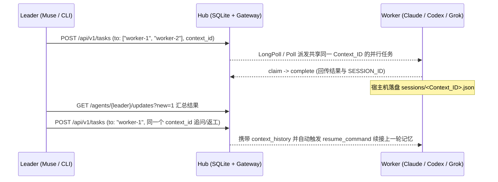

# 架构

## 这套系统解决什么问题

把多个 Agent（不同机器上的守护进程、云端机器人、人工触发的工具）组织成
一个可审计的协作系统：任务只有一个发起面和一个状态面，派发后不阻塞，
结果自动回到发起方；新增一个节点或一种能力，改动量是「加配置＋登记
一行能力」，而不是再写一套胶水。

载体选择：**SQLite WAL + 统一 HTTP 网关（出站长轮询 + 外部 HTTP Agent 接入）**，数据模型借
[A2A 协议](standard.md)。规范全文见 [中台标准](standard.md)，逻辑表结构见
[Schema 说明](base-schema.md)。

## 分层

## 核心决策与理由

1. **借 A2A 的数据模型，通信统一收敛到 HTTP + SQLite。** 沿用 A2A 的核心实体
   （Task / Message / Part / Artifact / AgentCard 与八态状态机），共享总线由 Hub
   单机本地 SQLite WAL 托管，节点侧只出站访问 HTTP API，不开任何入站端口。
2. **队列语义与状态收敛。** 宿主守护节点由内核代码机械执行认领租约、心跳、幂等去重、
   失败重试与跳数熔断；纯 HTTP 外部 Agent 经由 Hub 提供的 `agent-gateway` 网关
   （`/claim`、`/heartbeat`、`/ask`、`/auth`、`/complete`、`/fail`）获得一致的
   幂等校验与状态守卫。
3. **职责边界清晰（纯 5 表 A2A 模型）**：沟通与回执归 `Messages` / `Parts`（只追加）、状态与成果归 `Tasks` / `Artifacts`、能力与定时自报声明归 `AgentCards`；在途进程仅保存在执行节点本机 `runs/<Task_ID>/entry.json` 账本，不再维护独立的线上 `Runs` 或 `Rules` 表。
4. **能力按「可达资产」定义，不按所装软件。** 能力注册表
   （AgentCards）每个 Worker 一张名片，专长技能另起一行，本尊脚本技能
   单列。路由只查表；节点只接自己登记且可派发的能力，表外任务明确拒收
   并说明缺口——能力即边界。外部 Leader（如 Muse）以 `role=leader` 注册，
   既派单、跟 `updates`，也通过 `poll` / `claim` 接派给自己的任务。
5. **事件推送为主、低频对账为兜底。** 唤醒统一走 HTTP：`longpoll`（`LongPollBroker`
   写后毫秒级唤醒）或 `poll`（短轮询 / 定时扫表），均保留低频（默认 15 分钟）对账扫表作为安全网。
6. **节点只出不进，Hub 显式鉴权。** 边缘宿主节点与外部 HTTP Agent 只发起出站请求，
   不开监听端口、不做端口映射与反向隧道。Hub 侧对除 `/api/v1/health`、`/` 与
   `/.well-known/agent.json` 外的全部 `/api/*` 端点执行 Bearer Token 鉴权。
7. **指令与数据分离＋审批红线。** 任务参数只是数据（首条 instruction
   的 DataPart），宿主节点执行模板在本地 `commands.json`；参数里要求改权限、
   换执行者之类的字段一律忽略。对外发消息、删改数据、花钱、提交表单、改权限动作
   走 `auth-required` + ed25519 签名审批。
8. **小表轻载与结果摘要。** 凭据与敏感原文永不入表，大产出只存路径/URL 指针，
   结果回传统一「摘要＋指针」。

## 节点的三种接入形态

| | 宿主守护进程型 | 本地独立 Agent 型 | 纯 HTTP 外部 Agent |
|---|---|---|---|
| 代表 | `ah daemon --role node`（固定电脑） | `kind=agent` + `ah inbox` | 云端 **Muse**（Leader）、**Grok Bot**（Worker） |
| 纪律来源 | 守护内核代码强制（租约、心跳、重试） | 守护内核＋`ah inbox` 回执守卫 | `agent-gateway` 网关状态守卫 |
| 唤醒 | `GET /api/v1/poll` 长轮询或 `poll` 轮询 | 同左（写本机 `agent_inbox.jsonl`） | `/api/v1/agents/{node}/poll` 或 `/updates`（短轮询 / 长轮询） |

三种形态走同一套表与八态状态机（参见 [外部 HTTP Agent 手册](protocol-node-runbook.md)）。
守护进程型的内核是「薄壳」：不内嵌任何执行器，能力由节点本地的命令模板（`commands.json`）定义。

## 角色与传输（标准 §10）

- **hub 是逻辑角色，且为 node 的单进程超集。** 中台只有 node 与 hub 两个角色；
  hub 角色是 node 角色的单进程超集，由 `ah daemon --role node|hub`（CLI 简称 `ah`，别名 `a2a-hub` / `ahub`）承载。
  省略 `--role` 时读该配置目录 `node.json` 的 `role`，缺省 node。单进程单配置目录即可搞定，无需拆两个进程。
  `role=hub` 既像普通节点一样读取 `commands.json` 登记能力接单干活，又负责建单（入口 `ah task create`、Web 控制台与 HTTP API）、审批签名、结果呈递与陈旧任务告警。
  node 角色从不写 `auth_decision` 与 `canceled`，hub 角色是唯一写方。
  Hub 单进程启动本地 HTTP 网关（`src/server/http-server.mjs`，默认 `0.0.0.0:8787`），集中托管 `SqliteBus`（`src/bus/sqlite-bus.mjs`）、`LongPollBroker`（`src/server/longpoll-broker.mjs`）、`agent-gateway`（`src/server/agent-gateway.mjs`）、内置 Web 控制台（`src/server/web-ui.mjs`）与可选外部通知器（`src/hub/notifier.mjs`）。
  hub 逻辑代码主要在 `src/hub/` 与 `src/server/`。
- **鉴权与审批身份。** 通过机主 `AH_API_TOKEN` 与分 Agent Token（`agent_tokens.json`，绑定节点与角色，路由矩阵见 `src/hub/agent-access.mjs`）两类 Bearer Token 保护 Hub HTTP API，通过 `approval_key.pem` / `hubPublicKey`（ed25519 签名）校验审批真实性；远端宿主节点配置 `busType: "http"` 仅出站拉取总线并接受长轮询唤醒，外部纯 Agent 则经 Bearer Token 直接访问网关 REST 接口。
- **传输与门铃方式**，长轮询本身仍只是通知机制，任务与消息内容均按统一表模型校验读写：

  | 方式 | 机制 | 适用 |
  |---|---|---|
  | `longpoll` | 向 Hub 发起出站 `GET /api/v1/poll` 或 `GET /api/v1/agents/:node/poll?timeout=25`，`LongPollBroker` 写后毫秒级唤醒 | **推荐默认**：Hub、远端宿主节点与长连接 HTTP Agent |
  | `poll` | 定时轮询（守护节点默认 45s；云端 bot 按自身 cron/ticker 频率短轮询 `/agents/:node/poll`） | 无法维持长连接的定时器/无状态 HTTP Agent |

  所有守护节点保留低频对账扫表兜底（默认 15 分钟）以及面向 `input-required` / `auth-required` 的 `PENDING_RECHECK` 短复查机制。边缘执行节点本身**绝不开设任何监听端口**。

## 一件任务的生命周期

1. 调用方（CLI / Web 控制台 / Muse 等 Leader Agent）建单时先写 instruction 消息与
   Parts（参数在 DataPart），**最后写 Tasks 行**（`submitted`）。如果需要同时调度多个节点并行协同，可传 `to: ["node-a", "node-b"]` 批量扇出，共享同一个 `Context_ID`。
2. 目标节点被长轮询（或短轮询对账）唤醒，校验能力与幂等键，置 `working`、写
   `Claimed_By` 与心跳。
3. 需要补信息：写 question 消息 → 置 `input-required`；控制台或发起方呈递后，答复以 `answer` 消息
   追加在**原任务**上，目标续跑——禁止为答复新开任务。
4. 需要批准：写 `auth_request` → 置 `auth-required`；机主在 Web 控制台或审批 API 操作后，hub 角色用私钥签名并写 `auth_decision`（DataPart 载决定）。认领前
   （`Claimed_By` 为空）的批准回置 `submitted`，节点再认领执行；执行中
   （`working → auth-required`，`Claimed_By` 非空）的批准保持 `auth-required`，
   由原节点或外部 Agent 验签后切回 `working` 从断点续跑；驳回则 `canceled` / `rejected`。
5. 交付：若配了 `verify` 则先执行 L1 验收，产物登记 Artifacts（内容为其 FilePart）→ 写 result 消息（Seq 2 写入验收摘要 DataPart）→
   置 `completed`。
6. 失败：未达重试上限（2）回
   `submitted` 重认领，达上限置 `failed` 并写 `notice`（`verify` 未通过不回 `submitted`，直接 `failed`）。
7. **Leader 扇出与 `Context_ID` 多轮记忆续接**：当已有任务进入终态，Leader（或发起方）在**同一 `Context_ID`** 下向同一 Worker 发起后续任务（`Ref_Task_IDs` 指回前任）时，宿主机守护进程自动读取本地 `sessions/<Context_ID>.json` 复用上一轮 CLI `Session_ID`（走 `resume_command`）并向 `runs/<Task_ID>/input.json` 注入 `context_history`，无需复杂静态 DAG 状态机即可实现多轮连续编排。全链路受 `Hop_Count > 8` 熔断保护。

## 一致性与故障模型

- **总线存储与写并发**：中台采用单 Hub 进程下的 SQLite WAL（`node:sqlite`）+ `client_token` 幂等去重，Messages 与 Parts 依然坚持只追加不修改。
- **终态不可变**：`completed` / `failed` / `canceled` / `rejected` 之后要继续，
  同 `Context_ID` 新开任务并引用前任。
- **陈旧回收**：`working` 任务 20 分钟无心跳视为节点放弃，可被重新认领；
  `direct` 执行账本 `runs/<Task_ID>/entry.json` 保障守护重启后不误杀也不双跑。
- **呈递与告警通道**：回执落入发起方本地 `present_queue.jsonl`（由 `ah present` 取走）；同时 `ExternalNotifier` 可向飞书群机器人 Webhook（可选通知渠道）、Bark、Telegram 或通用 Webhook 推送待批、提问、终态与陈旧任务提醒。
- **端边解耦**：边缘节点临时离线或重启时，任务安全停留在 SQLite/总线上等待重连，上线后长轮询 `cursor` 序号自动对齐（`resync`）并继续消费。

## 非目标

- 不把总线当大文件对象存储：大产出走本地路径 / Git / 对象存储，表里只存指针。
- 不做复杂多租户联邦权限中心：单 Hub 服务于机主自身名下的一组受控节点与独立 Agent。
- 不追求分布式两阶段提交（2PC）：依靠幂等键、状态乐观校验与对账实现实用可靠的「不双跑、不漏单」。
